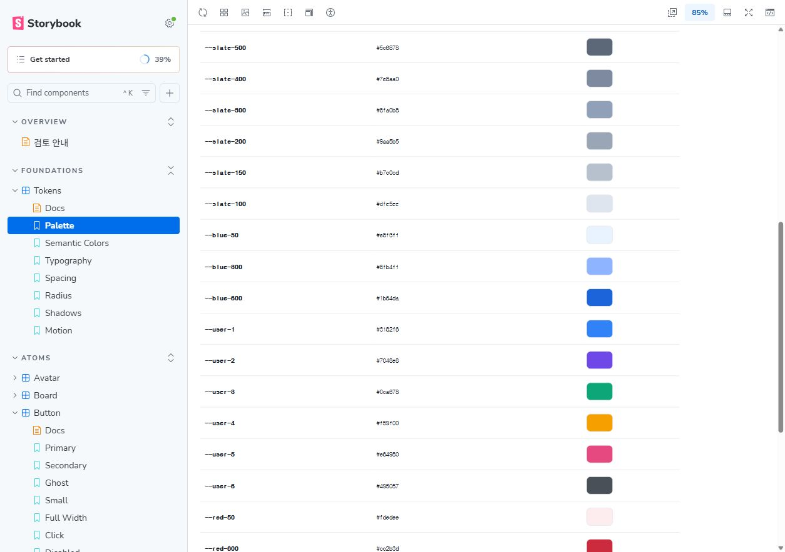
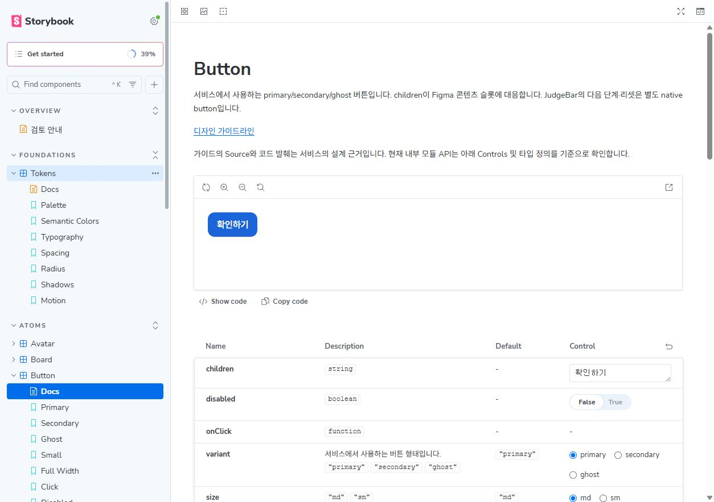
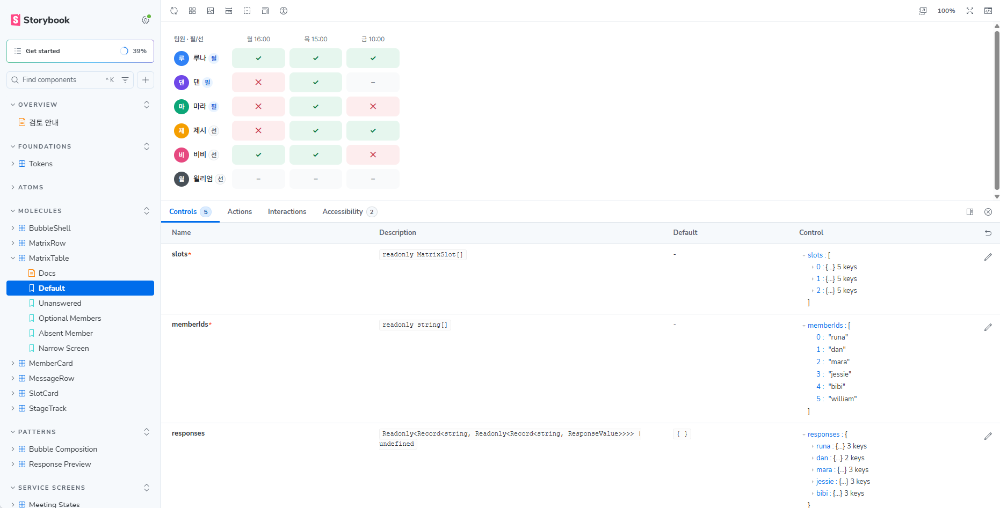
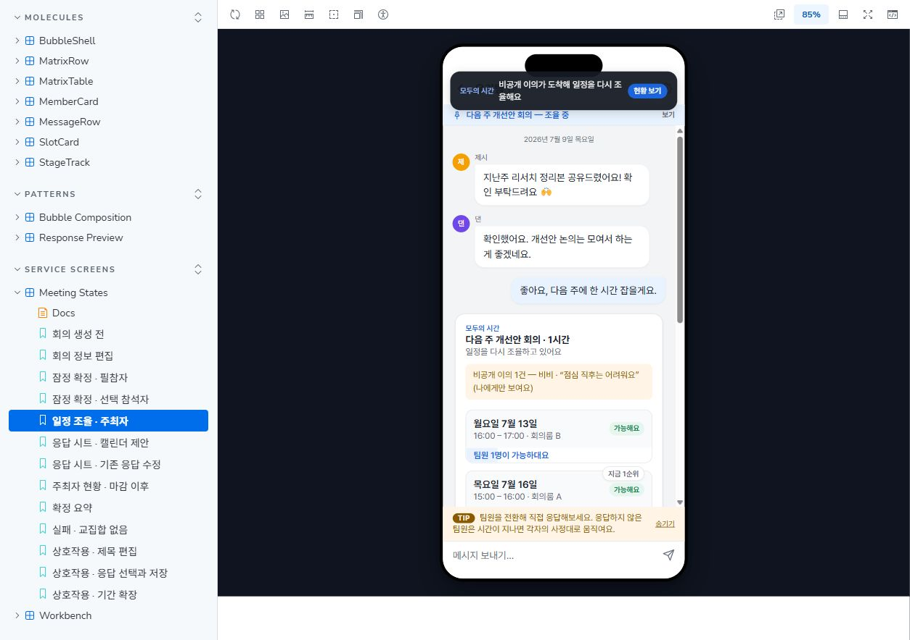

# modu-design-system

모두의 시간 서비스를 구성하는 React + TypeScript 디자인 시스템입니다. Atom 18개(아이콘 4개 포함), Molecule 7개와 MembersProvider를 제공합니다.

이 저장소는 서비스에서 사용하는 **디자인 시스템을 분리해 살펴보는 공간**입니다. Storybook에서 토큰, 개별 컴포넌트와 상태, 컴포넌트 조합 및 화면 안에서의 사용 예제를 확인할 수 있습니다. 서비스 전체 구성과 원본 코드, 디자인 시스템이 실제 화면에 연결되는 맥락은 [modu 저장소](https://github.com/RunaUXLabs/modu)에서 함께 확인할 수 있습니다.

## Storybook 미리보기

<table>
  <tr>
    <td width="50%" valign="top">
      <strong>파운데이션 · 컬러 토큰</strong><br>
      <a href="docs/images/storybook-foundations.jpg"></a>
    </td>
    <td width="50%" valign="top">
      <strong>아톰 · Button</strong><br>
      <a href="docs/images/storybook-atoms.jpg"></a>
    </td>
  </tr>
  <tr>
    <td width="50%" valign="top">
      <strong>분자 조합 · MatrixTable</strong><br>
      <a href="docs/images/storybook-molecules.png"></a>
    </td>
    <td width="50%" valign="top">
      <strong>서비스 전체 화면 · 일정 조율</strong><br>
      <a href="docs/images/storybook-service-screen.jpg"></a>
    </td>
  </tr>
</table>

## 저장소 구조

```text
src/                  공개 컴포넌트, 타입, 토큰, 스타일, 단위 테스트
stories/              Foundations / Atoms / Molecules / Patterns / Service Screens
.storybook/           독립 Storybook 설정
examples/service/     서비스의 feature/page/CSS 스냅샷, 예제 전용
docs/                 가이드라인, API, 구현 및 검증 기록
```

`examples/service`는 공통 컴포넌트의 사용 맥락을 보여주기 위한 화면 예제입니다. 이 저장소만으로 Storybook을 실행할 수 있으며, 예제와 Storybook은 배포 패키지에 포함하지 않습니다. 서비스 전체 구현을 이 저장소에서 관리하는 것은 아닙니다.

## 개발

Node 22.13.0 이상, pnpm 12.11.2가 필요합니다. 의존성 설치는 개발자가 직접 수행합니다. `packageManager`는 버전을 고정하지만 기존 실행 파일이나 Windows PATH를 교체하지는 않습니다.

```powershell
pnpm --version
pnpm install --frozen-lockfile
pnpm run check
pnpm run storybook
```

Storybook 기본 주소는 `http://localhost:6008`입니다. 서비스 Storybook의 기본 포트 6006과 분리했습니다. 실행 중인 터미널에서 `Ctrl+C`로 종료한 뒤 다시 실행하세요. 포트가 사용 중이면 `pnpm exec storybook dev -p 6011 --no-open`으로 다른 포트를 지정할 수 있습니다. VS Code 실행 문제는 [실행 환경 점검](docs/storybook-guide.md#vs-code-실행-환경-점검)을 참고하세요.

```powershell
pnpm run typecheck:storybook
pnpm run test:service-stories
pnpm run build:storybook
```

`check`는 라이브러리 테스트와 빌드를 실행합니다. 서비스 예제 테스트와 Storybook 검증은 별도입니다. pnpm 설치 스크립트 승인은 기존 `pnpm-workspace.yaml`의 esbuild 허용을 유지합니다. 의존성을 변경할 때만 `pnpm install --no-frozen-lockfile`로 lockfile을 갱신합니다.

## 패키지 사용

```tsx
import { Button, MembersProvider, Avatar } from 'modu-design-system';
import 'modu-design-system/style.css';

const members = { dan: { id: 'dan', name: '댄', required: true } };

export function Example() {
  return <MembersProvider members={members}>
    <Avatar id="dan" size="sm" />
    <Button onClick={() => console.log('confirm')}>확인하기</Button>
  </MembersProvider>;
}
```

`build`는 ESM, 타입 선언, `style.css`, `tokens.css`를 `dist/`에 생성합니다. JS import만으로 CSS를 자동 주입하지 않습니다. 토큰만 사용한다면 `modu-design-system/tokens.css`를 import합니다. React와 React DOM은 소비 앱이 제공하는 peer dependency입니다. Pretendard 파일은 포함하지 않으며 폰트 로딩은 소비 앱이 담당합니다. React 19 peer 범위는 선언했지만 실행 검증은 React 18 기준입니다.

로컬 설치 산출물은 `pnpm pack --pack-destination ./artifacts`로 만들고 소비 앱에서 `pnpm add <tarball 경로>`로 설치합니다. 현재 `modu`는 내부 모듈을 사용하므로 이 패키지에 자동 연결되지 않습니다.

## 문서

- [Storybook 실행 및 검토](docs/storybook-guide.md)
- [Storybook 목적과 범위](docs/storybook-scope.md)
- [컴포넌트 가이드라인](docs/design-system/README.md)
- [토큰 명세](DESIGN-SYSTEM.md)
- [패키지 API](docs/package-api.md)
- [구현 계획](docs/implementation-plan.md)
- [SSOT 점검 이력](docs/ssot-audit.md)

SSOT는 실제 서비스 코드입니다. Figma 슬롯과 React children/props를 구분하며 문서만으로 variant를 추가하지 않습니다. Button은 primary/secondary/ghost만 지원합니다. 회의 상태, 저장·마감 처리 및 화면 셸은 공개 API가 아닙니다.

## GitHub 및 배포

소스, 설정, 문서, `examples/service`, `pnpm-lock.yaml`을 함께 관리합니다. `node_modules`, `dist`, `storybook-static`, tarball은 Git에서 제외합니다. 별도 저장소를 체크아웃해 설치한 뒤 라이브러리와 Storybook을 각각 빌드할 수 있습니다.

Storybook은 [GitHub Actions](.github/workflows/deploy-storybook.yml)로 빌드하고 GitHub Pages에 배포합니다. 저장소의 **Settings → Pages → Build and deployment → Source**를 **GitHub Actions**로 설정하세요. `main`에 푸시하거나 Actions에서 수동 실행하면 테스트·Storybook 타입 검사·정적 빌드 후 `storybook-static/`을 게시합니다. 라이브러리의 `dist/`나 저장소 루트를 게시하는 방식이 아닙니다.

공개 주소는 `https://runauxlabs.github.io/modu-design-system/`입니다. 배포가 실패하면 README 상단의 배포 상태 링크에서 실패한 단계를 확인하세요. 로컬 수정만으로 공개 사이트가 갱신되지는 않습니다.

현재 `private: true`는 npm 발행만 차단하며 Storybook의 Pages 배포와는 별개입니다. npm 발행은 자동화하지 않았습니다. 비공개 레지스트리 발행 시 scope·이름·레지스트리·접근 정책을 결정하고 인증은 사용자 설정 또는 CI secret으로 공급해야 합니다.
